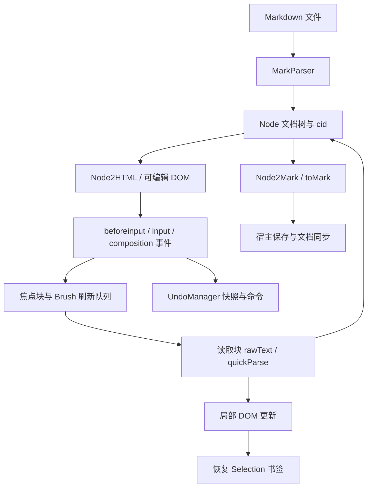

# Typora 1.7.6 实时 Markdown 编辑实现分析

分析日期：2026-10-22。对象为用户提供的 Windows x64 安装包。本文覆盖编辑器主链路，并给出当前项目的可复用实现入口；安装包中的压缩代码不能恢复成带原始注释、完整类型和构建配置的开发源码。

## 证据与复现

| 项目 | 实测结果 |
| --- | --- |
| 安装包 | `typora-setup-x64-1.7.6.exe`，83,448,184 bytes |
| SHA-256 | `959cfdb3c45e5141e35c13ed0b0e2ab00aad1275db16b7d07652f1f5b70bd563` |
| Authenticode | 本机检查为 `Valid`；签名主体 Qiyun (Shanghai) Tech Ltd. |
| 安装格式 | Inno Setup data 6.0.0 unicode |
| 应用元数据 | `resources/package.json`：version 1.7.6，main `main.node`，private true |
| Electron version 文件 | `app/version`：24.8.3 |
| 主渲染脚本 | `resources/appsrc/window/frame.js`，1,636,017 bytes |
| 渲染脚本 SHA-256 | `3a1a1294d840ac7d5fff820426ec272b3cce80ab025c0d925a737775a9ba59ae` |
| 静态拆分 | 88 个 `$__System.registerDynamic` 模块 |
| 资源清单 | 335 个 resources 文件；未发现 `.map` 文件 |
| ASAR 内容 | app.asar 3 个条目；lib.asar 22 个条目；node_modules.asar 2,925 个条目 |

使用 [innoextract 官方工具](https://constexpr.org/innoextract/) 静态解包，没有运行安装程序或应用程序。格式化使用 Prettier 3.6.2，语法解析使用 @babel/parser 7.28.5；原脚本作为数据读取，没有执行模块工厂。

当前工作区保留了以下本地研究材料，位于已被 Git 忽略的 `.toolchains/typora-research/`：

- `1.7.6/app/resources/`：安装包中的资源。
- `inspection/modules/module-<ID>.js`：88 个格式化后的模块。
- `inspection/inventory.json`：模块依赖、原脚本字符区间、原片段与格式化后 SHA-256、ASAR 目录、资源清单。
- `core-build.log`、`core-tests.log`：可复用核心的构建和测试记录。

仓库工具 `tools/inspect_typora.mjs` 可重新生成分析目录，调用方式：

```powershell
node tools/inspect_typora.mjs `
  .toolchains/typora-research/1.7.6/app/resources `
  .toolchains/typora-research/inspection-new `
  .toolchains/typora-research/parser-tools/node_modules
```

输出目录必须不存在。索引中的 start/end 是 UTF-16 字符位置，end 不包含在片段中，不是二进制字节偏移。工具通过 AST 定位模块调用，没有用正则猜测函数结束位置。

参考网页 [《typora 保护机制与注册逆向分析》](https://bbs.kanxue.com/thread-279448-1.htm) 提供了 Electron 资源布局与主进程入口保护的背景。本文关于实时编辑的结论来自安装包渲染脚本的静态检查。该文章未提供完整的实时编辑架构说明。

## 程序入口与真正的编辑核心

`resources/window.html` 直接加载 `appsrc/window/frame.js`，同时引用 base.css、CodeMirror 样式、MathJax、Mermaid 样式与 PDF 组件。`page-dist/` 里的设置、欢迎与授权界面不等同于主编辑器。

`app.asar` 仅有 `atom.js`、外置的 `main.node` 条目和 package.json。分析实时编辑不需要先还原主进程启动代码：主要编辑模块已经位于可读的 frame.js 中。这里没有分析 atom.js 或执行主进程，因此不声称已恢复 Typora 的整个程序。

模块编号来自这个版本，升级后可能改变。下表的主要名称取自模块 45 中保留的 require 绑定与模块方法，便于搜索本地研究文件。

| ID | 名称/职责 | 可定位方法或标识 |
| --- | --- | --- |
| 45 | Editor 编排与事件 | `_bind…`、`simpleParse`、`getMarkdown`、`syncChange`、`applyChange` |
| 13 | NodeDef / 文档树 | Node、TYPE、children、parent、pool、cid |
| 19 | MarkParser | `parseFrom`、`parseInline`、`quickParse`、InlineLexer |
| 12 | Node2Mark | `toMark`、`markFromArr` |
| 14 | Node2HTML | `toHTML`、cid、mdtype、contenteditable |
| 1a | NodeOperation | `normalizeNode`、`smartSplit`、`splitAt`、`wrap`、`unwrap` |
| 2a | Brush / 延迟块刷新 | `addToQueue`、`brushQueue`、`brushNode`、`expand` |
| 31 | Selection | `saveSelection`、`getPosBookmark`、`buildUndo`、`restoreSelection` |
| 1b | UndoManager | `register`、`addSnap`、`endSnap`、`exeCommand`、undo/redo |
| 18 / 20 | Fences / CodeMirror | 代码围栏子编辑器及编辑引擎 |
| 3a | SourceView | CodeMirror 源码模式、show/hide、onSave |
| 1c / 27 | MathBlock / MathInline | 块级和行内公式 |
| 46 | TableEdit | 行列插入删除、对齐、单元格导航 |
| 5f / 52 | 剪贴板处理 / HTML 解析 | `pasteHandler`、`copyHandler`、`parseHTML` |
| 47 / 48 | File / FileAction | 保存、备份、文档状态、模式切换 |

## 从键入到保存的完整主链路



### 1. 文档树与 DOM 之间有稳定标识

模块 13 定义段落、标题、列表、表格、代码块、公式、HTML、链接、强调等节点类型。节点保存 attributes、children、parent，进入 Node.pool，并获得 `n...` 形式的 ID。模块 14 生成带 `cid` 和 `mdtype` 的 DOM，按节点性质控制 contenteditable。

编辑器因此能从 DOM 中定位文档节点，也能用 cid 找回对应元素。DOM 不是保存格式：序列化由文档树的 `toMark()` 完成。源码模式下，模块 45 的 `getMarkdown()` 则读取 SourceView 中 CodeMirror 的内容，再按配置处理末尾换行。

### 2. 浏览器原生输入与结构命令协作

模块 45 绑定 beforeinput、input、compositionstart/end 等事件。它根据 inputType 区分普通插入、替换、删除和组合文本，并维护 focusCid。普通输入可以先改变可编辑 DOM；输入事件再把受影响块加入 Brush 队列，并通知 UndoManager。

Enter、Backspace、列表缩进、表格等具有文档结构语义的操作不能仅靠浏览器默认行为。它们走 NodeOperation、UserOp、TableEdit 等专门命令，维护节点、DOM 和撤销信息。`simpleParse()` 对可能产生新块结构的内容重新解析，例如标题、列表或围栏开头。

### 3. Brush 将变化限制在块内

模块 2a 的默认 interval 是 200 ms，队列项包含 cid 和 inlineOnly。brushQueue 按 cid 去重；组合输入或鼠标选区操作期间暂缓处理。执行前保存选区。

对叶子块，它读取 rawText 并调用 MarkParser.quickParse。行内变化时，比较归一化后的旧 HTML 与新 HTML，确有变化才替换该块的内部内容；块结构变化时，根据结果替换相应节点和元素。随后处理公式、焦点、书签偏移及撤销命令。

这解释了实时编辑的核心要求：更新范围要足够小，并且必须把光标恢复视为渲染的一部分。全篇 innerHTML 替换会让 DOM Range 失效，容易打断输入法、拖选和连续输入。

### 4. 编辑中的 Markdown 标记按选区展开

Brush.closestExpandable、expand 与 `.md-expand` 等类负责当前行内结构的展开。用户看到的格式化内容和可输入的语法表示可以随选区变化，块和行内节点仍有稳定身份。源码标记的可见性与原文序列化是两个不同问题。

Selection 模块包含基于节点和偏移的书签，以及 Range 保存/恢复函数。刷新代码使用 cursorDiff 等信息修正文本转换引起的偏移变化。直接保存 `window.getSelection()` 的节点引用无法跨 DOM 重建长期使用。

### 5. 中文输入法需要独立生命周期

模块 45 在 compositionstart 设置 isIME；compositionend 将焦点块重新入队、清除组合标记、安排刷洗并补充撤销快照。模块 2a 在 isIME 时跳过刷新。代码还处理 compositionend 与后续 input 事件之间的时序。

工程含义是：拼音候选尚未提交时不要重新解析并替换正在输入的 DOM；最终提交后再同步模型与视图。宿主保存回声也不能在此时把光标恢复到组合开始前的位置。

### 6. 撤销记录结构操作与光标

模块 1b 用 commandStack 和 index 管理历史。命令带 undo/redo 数组，支持光标、块替换、插入删除、属性、代码围栏位置和同步等操作；连续输入通过快照合并，不是每个键都完整重载文档。

源码模式和子编辑器有各自适配路径。例如源码模式中的撤销委托给 CodeMirror，富文本模式则执行 UndoManager 命令。跨模式历史是否完全等价需要动态验证，静态检查不能直接保证。

### 7. 代码、数学、图表和表格采用专门编辑路径

围栏代码使用 CodeMirror 子编辑器；数学模块把可编辑内容与 MathJax 结果关联；图表通过独立渲染资源处理；表格需要行列与单元格导航命令。把这些元素都交给同一个 contenteditable 默认行为，无法获得稳定的边界处理。

### 8. 保存与实时编辑是两层协议

模块 45 的 syncChange 发送块级同步内容和命令；完整同步有单独的 scheduleFullContentSync 路径。module 47 维护文档状态、保存和备份。一次键入的视觉刷新不应依赖文件写入成功，也不应因保存完成而重新创建编辑器。

## 在 SpringNote 中对应怎样实现

当前项目已经有 Open Typora 实现。这里新增 `src/live-markdown-core.ts`，把已有核心封装成普通 DOM API，并提供单独的构建、示例页、测试和导出包。

| 能力 | 当前项目入口 | 与观察到的 Typora 做法的关系 |
| --- | --- | --- |
| Markdown 模型 | `vendor/open-typora/src/editor/model.ts` | 保存原文、块范围、稳定 ID 和历史；原文是持久化基准 |
| 输入处理 | `RichEditor.ts` | beforeinput、input、paste、composition 进入模型操作 |
| 块解析 | `markdown.ts` | 使用 markdown-it；不是 Typora 的 MarkParser |
| 渲染 | `richRender.ts`、`RichEditor.render()` | 缓存未变块，重用 DOM；叶子 positions 映射到源码偏移 |
| 语法显隐 | `RichEditor.expandInline()` 与样式 | 根据光标展开当前行内结构 |
| 输入法 | `composition.ts`、RichEditor 组合处理 | 延迟重绘，最终提交为一组历史 |
| 复杂块 | CodeMirror / MathJax / Mermaid 模块 | 专门处理代码、公式和图表 |
| 宿主接口 | 新增 `live-markdown-core.ts` | mount、snapshot、setMarkdown、select、命令、历史、destroy |
| Flutter 同步 | `lib/core/editor/open_typora_session.dart` | 文档 ID、revision、sequence 检查与保存回声过滤 |

二者有相似的编辑约束，但具体实现不同。Typora 观察到的主路径偏向“浏览器 DOM 输入 → 块刷洗 → 文档树”；当前 Open Typora 更偏向“源码模型变更 → 块解析 → DOM 更新”，并为原生输入和 IME 提供协调。当前模型会重新解析整份受支持的正文，再重用未变块 DOM；不能把它描述成已经实现局部增量语法解析。大文档性能是后续可进一步优化的方向。

## 导出物与边界

可复用包的用法见 [reusable-core.zh-CN.md](./reusable-core.zh-CN.md)。它包括构建产物、示例、源代码、许可证、第三方声明、Flutter 适配参考和文件校验清单。

本地 Typora 研究模块保留在被忽略的目录中。安装包自带 LICENSE 标注 “All Rights Reserved”；当前没有可用于把其专有编辑器代码作为项目源码分发的授权证据。项目导出包由已有 MIT 实现及新增接口组成。

未完成或未验证的范围包括：主进程入口还原、Typora 原程序动态运行、完整语法与边缘行为逐项比对、超长文档性能、所有桌面输入法，以及 macOS WebView 实机行为。本文结论不代表 Typora 完整工程源码已被恢复，也不代表两个编辑器行为完全一致。
